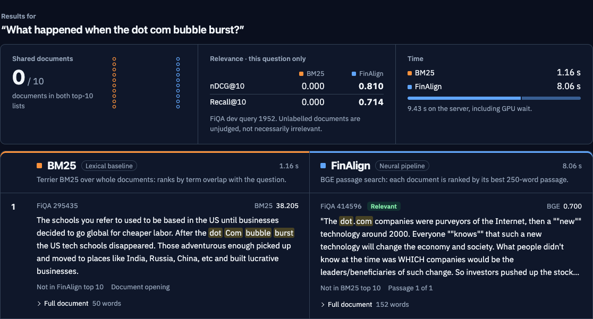
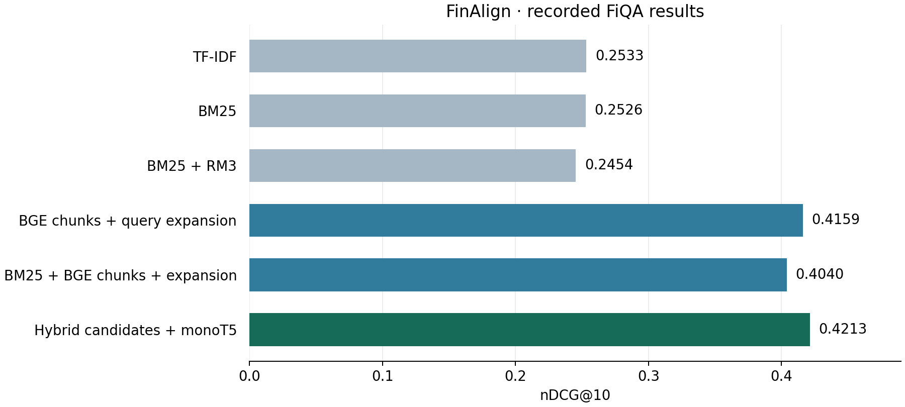

# FinAlign

Can semantic retrieval find relevant financial answers that keyword search misses? FinAlign compares BM25 with a passage retriever, then tests how query expansion, lexical fusion and reranking change the ranking.

In the recorded course experiment, the complete pipeline reached **nDCG@10 of 0.4213**, compared with **0.2526 for BM25**. Most of the improvement came from dense retrieval with query expansion; adding lexical scores did not improve that configuration on its own.

## Try the live demo

[](https://huggingface.co/spaces/pdmdp/finalign)

**Public and free to try:** pick an example, or enter an English question and click **Compare rankings**; select **All stages** and rerun to try the complete pipeline.

<a href="https://huggingface.co/spaces/pdmdp/finalign">
  
</a>

## How the search works

BM25 matches the question's terms against whole documents. The neural pipeline splits documents into 250-word passages and uses `bge-base-en-v1.5` to retrieve passages by meaning. `Qwen2.5-1.5B-Instruct` supplies two extra search inputs: financial keywords and a hypothetical answer. The original query and the two variants receive weights of 0.70, 0.15 and 0.15 after score normalization.

Each document is represented by its best passage. Its dense score can be combined with BM25, and `monot5-base-msmarco` reranks the first 50 candidates. Generated text is used to search the collection; the system returns ranked documents rather than a generated answer.

[Notebook](notebook/Fin_IR_Project.ipynb) · [Report](report/FinalReportIRProject.pdf) · [Slides](FinAlign-Slides.pdf) · [Method and setup](EXPERIMENT.md)

## Results



| Configuration | nDCG@10 | MAP |
| :--- | ---: | ---: |
| TF-IDF | 0.2533 | 0.2096 |
| BM25 | 0.2526 | 0.2104 |
| BM25 + RM3 | 0.2454 | 0.2065 |
| BGE chunks + query expansion | 0.4159 | **0.3569** |
| BM25 + BGE chunks + query expansion | 0.4040 | 0.3410 |
| Hybrid candidates + monoT5 | **0.4213** | 0.3561 |

nDCG@10 measures how highly relevant documents appear in the first ten results. Reranking recovers the highest nDCG@10 after lexical fusion lowers it; the dense pipeline retains the highest MAP. These are saved notebook results, with [values and provenance](results/recorded_metrics.json). Live demo searches are separate executions.

## Contribution

**Matteo Pietro Di Pilato, Lorenzo Cinquemani and Lorenzo Marchioni** · Information Retrieval and Recommender Systems, BSc in Artificial Intelligence. Matteo implemented the retrieval pipelines and ran the evaluation. The interactive application is a later extension.

## Limits and next experiment

The same 648 FiQA test queries informed the original design choices and evaluation. The results are exploratory, and statistical significance was not established for the final neural comparisons. MAP also depends on the different ranking depths returned by the systems.

The [next experiment](demo/EXPERIMENTS.md) specifies three comparisons, development-set parameter selection and paired analysis on the test queries, retaining the limitation that this test set was used before.

The demo searches 57,600 nonempty documents and 66,113 passages from the historical FiQA collection. Shared ZeroGPU queues and daily limits apply; BM25 remains available when the neural allowance is exhausted. These documents and generated query variants are not current financial advice.

## Run

```bash
git clone https://github.com/pdmdp/FinAlign.git
cd FinAlign
python -m pip install -r requirements.txt
python -m jupyter lab notebook/Fin_IR_Project.ipynb
```

The notebook expects CUDA and a Java JDK. See [notebook setup](EXPERIMENT.md) for the original environment and indexing behaviour, or [demo setup](demo/DEPLOY.md) to run the application. [Validation](demo/VALIDATION.md) records the execution checks. The result figure can be regenerated with `python scripts/plot_results.py` and Matplotlib.

Code: [MIT](LICENSE). Datasets and pretrained models retain their own licenses.
