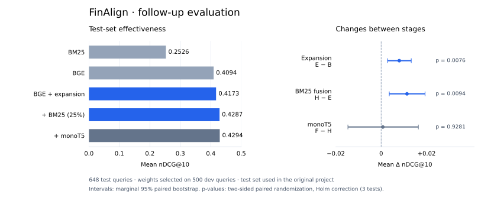

# FiQA follow-up evaluation

Query expansion and a modest lexical contribution improved retrieval in this run. Reranking produced the highest mean score, but its additional gain was too small to distinguish from query-level variation with the planned test.



The 648 test queries had influenced the original coursework design. Selecting parameters on dev before this run does not make that test set an untouched holdout. These results describe a retrospective follow-up on FiQA.

## Selection on dev

The [predefined plan](../../demo/EXPERIMENTS.md) compared five expansion settings on all 500 dev queries, followed by five lexical weights. The selected expansion weights were **0.70 original query, 0.15 keywords, 0.15 hypothetical answer**. The selected fusion was **75% normalized dense score and 25% normalized BM25 score**. No test result was used to select these weights in this run.

The configuration was frozen at 21:14:15 UTC on 15 November 2026; the test stage started at 21:14:22 UTC. The [dev selection](dev_selection.json), [frozen configuration](frozen_config.json) and [test-start record](test_started.json) retain those choices and timestamps.

## Test results

| ID | System | nDCG@10 | Recall@10 |
| :--- | :--- | ---: | ---: |
| L | Terrier BM25 | 0.252634 | 0.309708 |
| B | BGE, original query | 0.409367 | 0.483040 |
| E | BGE + keyword and hypothetical-answer expansion | 0.417338 | 0.489610 |
| H | E + BM25, alpha 0.25 | 0.428715 | 0.504743 |
| F | monoT5 reranking of H's first 50 candidates | 0.429442 | 0.507297 |

Each mean uses all **648 test queries**. nDCG@10 is the primary metric. Recall@10 is descriptive; no additional hypothesis tests were performed for it or for the full pipeline against BM25.

## The three planned comparisons

| Comparison | Mean Δ nDCG@10 | Marginal 95% bootstrap interval | Holm-adjusted p | Improved / tied / worsened |
| :--- | ---: | :--- | ---: | ---: |
| E − B: query expansion | +0.007971 | [0.002810, 0.013252] | 0.007620 | 119 / 447 / 82 |
| H − E: lexical fusion | +0.011377 | [0.003574, 0.019321] | 0.009360 | 151 / 380 / 117 |
| F − H: reranking | +0.000727 | [−0.014645, 0.016394] | 0.928051 | 181 / 288 / 179 |

The analysis used 20,000 paired bootstrap samples and 100,000 two-sided sign randomizations. Holm correction covers the three comparisons as one family at alpha 0.05. The bootstrap intervals are marginal, not simultaneous. Seeds and settings are retained in [summary.json](summary.json).

Expansion and lexical fusion passed the corrected significance threshold. Their mean gains are modest, and each also worsened some queries. Reranking improved 181 queries and worsened 179; its interval includes both gains and losses. A nonsignificant result does not establish equivalence.

[Per-query differences](paired_differences.csv) · [All system scores per query](per_query.csv) · [Difference distributions](paired-differences.svg)

## What changed from the original experiment

The coursework used equal-weight lexical fusion and recorded a lower score after adding BM25. This follow-up selected a 25% lexical weight on dev and found a positive test-set difference relative to expanded BGE. The original observation was specific to its configuration; it does not support a general claim that BM25 hurts neural retrieval.

The two runs are kept separate. Model/library versions and execution conditions are recorded for this follow-up, so a numerical difference from the coursework cannot be attributed to the new weight alone. The live demo continues to use its existing settings.

## Reproduce and inspect

[Open the Colab notebook](https://colab.research.google.com/github/pdmdp/FinAlign/blob/main/experiments/run_colab.ipynb) · [Runner and protocol](../../experiments/README.md) · [Generated report](REPORT.md)

The run used a Colab T4, Python 3.13.16 and PyTorch 2.8.0 with CUDA 12.6. [context.json](context.json) records source, index and model revisions; [environment-lock.txt](environment-lock.txt) records the actual packages. Source commit: `f0c006a328694de8c31bb09b398a19136f027032`.

The downloaded archive was checked against all 2,446 checkpoint identities and checksums. Both dev grids were recomputed, and all 3,240 query-system metric pairs were checked against the saved rankings and `ir_measures`. Recomputing the statistical analysis reproduced the retained numbers within 1e−12. See [verification.json](verification.json).

The Colab report stage saved the tables and statistics before failing at the figure stage. The missing distribution figure was regenerated locally from the saved results with the original report code; retrieval and model inference were not repeated. The underlying Colab plotting exception was not available in the supplied log.

This directory contains the numerical report, per-query scores, selection records and figures. The full component cache and rankings remain in the downloaded run archive; its SHA-256 is in the verification record. The overview figure can be recreated from `summary.json` with:

```bash
python experiments/plot_results.py
```

FiQA/BEIR data and attribution are described in [DATA.md](../../demo/DATA.md). The original coursework notebook and report remain unchanged.
