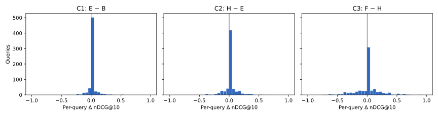

# FinAlign follow-up results

The 648 test queries informed the original coursework design. This is a retrospective follow-up, not an untouched holdout.

Complete paired set: 648 test queries. Primary metric: nDCG@10.
Dev-selected weights: [0.7, 0.15, 0.15]; BM25 alpha: 0.25.
Frozen configuration SHA-256: `e2903c27f45711a6c9dfced951fde0731429a3aa5ee9e59583147d13f779b5cf`.

| System | nDCG@10 | Recall@10 |
| :--- | ---: | ---: |
| L | 0.252634 | 0.309708 |
| B | 0.409367 | 0.483040 |
| E | 0.417338 | 0.489610 |
| H | 0.428715 | 0.504743 |
| F | 0.429442 | 0.507297 |

L: BM25; B: original-query BGE; E: expanded BGE; H: lexical fusion; F: monoT5.

| Comparison | Mean delta | Marginal 95% bootstrap CI | Win / tie / loss | Raw p | Holm p |
| :--- | ---: | :--- | :--- | ---: | ---: |
| C1: E - B | 0.007971 | [0.002810, 0.013252] | 119 / 447 / 82 | 0.002540 | 0.007620 |
| C2: H - E | 0.011377 | [0.003574, 0.019321] | 151 / 380 / 117 | 0.004680 | 0.009360 |
| C3: F - H | 0.000727 | [-0.014645, 0.016394] | 181 / 288 / 179 | 0.928051 | 0.928051 |

Three two-sided paired randomization tests, with Holm correction as one family.
The 95% bootstrap intervals are marginal, not simultaneous intervals.
All comparisons, including null and negative effects, are retained. Non-significance does not establish equivalence.
BM25 is a descriptive reference; no extra significance test against the complete pipeline was performed.
Historical coursework scores are not combined with this run.

